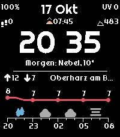
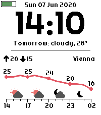

# Pebblecast DE

A German Pebble Time 2 watch face that visualizes the weather for the next 12 hours. Written in C.

Pebblecast DE is a modified version of [Pebblecast Weather](https://github.com/ConstantinMatheis/pebblecast-weather) by Constantin Matheis. It has been modified by [jonathan-1414](https://github.com/jonathan-1414) since October 2026; see [Changes from the original](#changes-from-the-original).

If you enjoy the original watch face, consider buying its author a hot beverage.

[](https://www.paypal.me/constantinmatheis)

## Screenshots




## Supported Watches

- Pebble Time 2

## Notable features

- Light and dark themes
- Celsius and Fahrenheit support
- Battery level in percent, date, and the UV index (today's maximum) in the top row; a Bluetooth icon replaces the UV index while the phone is disconnected
- Today's steps, the next sunrise or sunset, and the elevation of the current location above the time
- Short summary of tomorrow's weather (`Morgen: Nebel, 10°`)
- High and low temperatures for the current day
- Current location name (`Berlin`)
- Temperature line graph for the next 12 hours
- Weather icons showing how conditions change over the next 12 hours (e.g. a cloud for cloudy weather, a water droplet for rain, etc.)

## Changes from the original

- German texts for the date, month names and tomorrow's summary
- Redesigned top section:
  - Battery level in percent instead of a battery graphic
  - Larger date (21 px)
  - UV index in the top-right corner, replaced by the Bluetooth icon while disconnected
  - New info row with today's steps, the next sun event (sunrise or sunset) and the elevation
  - Larger time (52 px), with a space instead of the colon between hours and minutes
- Weather section is 15 px smaller, and tomorrow's summary sits directly above the divider
- Temperature plot:
  - Minimum span of 6°, so small temperature changes no longer look like large swings
  - Smaller gaps above and below the location row, which keeps the curve about 28 px tall
- Sunrise, sunset, UV index and elevation are additionally requested from Open-Meteo
- Only the Pebble Time 2 is supported; the compact layout for smaller watches and the black-and-white themes were removed

The changes were implemented with the help of Claude (Anthropic) as a coding assistant.

## Building & running

Running the `pebble` commands requires the Pebble SDK. See the [repebble SDK setup guide](https://developer.repebble.com/sdk/) for installation instructions.

```sh
pebble build                          # build for the Pebble Time 2
pebble install --emulator emery       # install on the emery emulator
```

If the emulator gets stuck, wipe it and clean the build files:
```sh
pebble kill && pebble clean && pebble wipe
```
