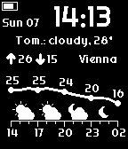
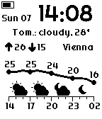

# Pebblecast Weather

A Pebble watch face that visualizes the weather for the next 12 hours. Written in C.

If you enjoy this watch face, consider buying me a hot beverage.

[](https://www.paypal.me/constantinmatheis)

## Screenshots

### Pebble Time 2


### Other black-and-white watches




## Supported Watches

- Pebble Time 2
- Pebble 2 Duo
- Pebble 2
- Classic, Steel
- Time, Time Steel

## Notable features

- Light and dark themes
- Celsius and Fahrenheit support
- Short summary of tomorrow's weather (`Tomorrow: cloudy, 28°`)
- High and low temperatures for the current day
- Current location name (`Vienna`)
- Temperature line graph for the next 12 hours
- Weather icons showing how conditions change over the next 12 hours (e.g. a cloud for cloudy weather, a water droplet for rain, etc.)

## Building & running

Running the `pebble` commands requires the Pebble SDK. See the [repebble SDK setup guide](https://developer.repebble.com/sdk/) for installation instructions.

```sh
pebble build                          # build for all target platforms
pebble install --emulator emery       # install on the emery emulator
```

If the emulator gets stuck, wipe it and clean the build files:
```sh
pebble kill && pebble clean && pebble wipe
```
